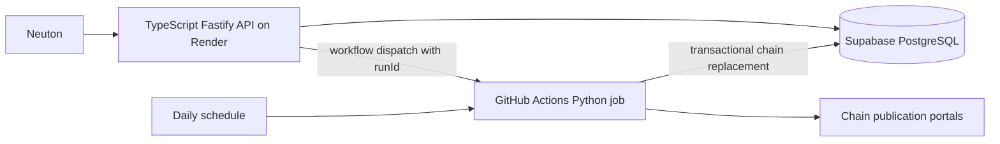

# Specification: supermarket ingestion service

Status: implementation-ready design for review; no implementation is included. Date: 2026-10-30.
Companion: [Search API specification](SPEC-supermarket-api.md). Read both before implementation. This document owns ingestion, shared SQL schema, refresh coordination, and publication semantics. The companion owns HTTP contracts and matching. Plans are embedded in these two documents at the user's request.

## 1. Purpose and customers

Neuton businesses need estimated ingredient and recipe costs when their own purchasing data is unavailable. Existing search covers Shufersal and Carrefour. Expand to ten chains without paid price APIs, keeping only current product averages. These are sampled retail estimates, not actual business acquisition costs, nationwide chain prices, availability promises, or promotion-aware offers.

Launch consumer: Neuton's backend only. Operators use protected refresh/status endpoints. Future consumers may be external app developers with API keys and agents through MCP and x402 payments. Design clean boundaries for that future; do not implement customer accounts, billing, wallets, MCP, or x402 in this release.

## 2. Agreed scope

Chain IDs are stable public identifiers:

| ID | Chain |
|---|---|
| shufersal | Shufersal |
| carrefour | Carrefour |
| rami-levy | Rami Levy |
| yochananof | Yochananof |
| osher-ad | Osher Ad |
| victory | Victory |
| mahsanei-hashuk | Mahsanei HaShuk |
| hatzi-hinam | Hatzi Hinam |
| tiv-taam | Tiv Taam |
| keshet-teamim | Keshet Teamim |

Every daily run randomly selects three distinct branches per chain anew. Use latest available PriceFull files only. No deltas, promotions, price history, raw-file retention, or branch-price persistence. Store one current row per product per chain, with its sampled arithmetic mean in `price`. Re-randomization may change an estimate without any underlying branch price change.

## 3. Topology and technologies



One future standalone repository, two deployable components: `services/api` and `services/ingestor`, plus `db/migrations`, `contracts`, and `.github/workflows`. Do not add the implementation to Neuton-Back by default. Its existing code is a reference and later integration target.

Python 3.12 baseline; pytest, Ruff, Psycopg 3, standard-library Decimal, and an XML parser configured to prohibit external entities. Lock exact dependency versions during bootstrap. Trial `israeli-prices` first for branch listing and full-file retrieval; use OpenIsraeliSupermarkets `il-supermarket-scraper` plus its parser if the trial fails. Do not claim a provider is supported until tested. Keep a provider adapter boundary independent of both libraries.

GitHub Actions runs the collection itself, not a long HTTP request to Render. Render hosts the search/control API. Supabase hosts shared PostgreSQL state. GitHub permissions are restricted to the repository/workflow required. No Redis, object storage, or permanent worker is required initially.

Cost constraints: zero recurring spend. Verify Actions allowance/runtime, Supabase database/egress limits, and Render allowance. Render native cron is paid and must not be silently introduced. Geo-blocked chains may remain unavailable; never purchase a proxy automatically. Pilot from the actual hosted runner, not only an Israeli development machine.

## 4. Explicit engineering defaults

These complete previously unspecified details; they are design defaults, not additional user promises:

- Source timestamp older than 48 hours is stale. Keep searchable data regardless of age, with accurate freshness. A successful old-file ingestion is not labeled fresh.
- Branch eligibility: a physical grocery branch with a discoverable full catalog. Exclude identifiable pharmacy-only and online-only subchains; do not apply the earlier proposed geographic stratification or express-format exclusion. Uniform random sampling over eligible branches.
- Three branch slots, each at most three distinct branch attempts: initial plus two replacements. At most nine application-level branch attempts per chain. Do not hide unbounded retries inside adapters.
- A structurally valid nonempty catalog is required for branch success. An empty/malformed catalog is an attempt failure. Invalid individual rows are skipped and counted; zero valid rows makes the branch fail.
- Runtime budget 45 minutes per job; source HTTP timeout 60 seconds, explicit streaming byte limit 100 MB decompressed per branch, low concurrency initially (one branch at a time). Make these configurable and adjust from measured fixtures, never truncate and publish a partial branch silently.

## 5. Collection and replacement algorithm

1. Establish a run and reserve its chain set as described below. Load chain configuration and provider mappings.
2. List branches and full-price files. Parse branch identity from source metadata; use `(chain, subchain, store)` internally, never store number alone. Randomly shuffle eligible distinct branches once per chain/run; retain selected IDs in operational metadata for diagnosis, not branch prices.
3. For each of three slots, attempt the next unattempted branch. Download its latest complete PriceFull; parse and validate entirely before counting success. If it fails, use up to two replacement branches. Never retry an already attempted branch in another slot, or count a successful branch twice. If candidates are exhausted, stop attempting that slot. A chain with fewer than three eligible branches uses those available.
4. Parse from a network stream or transient memory only. Never write raw files to disk, CI artifacts, logs, caches, or database. If a library's default writes files, replace/configure that behavior before using it. A normalized in-memory aggregate is allowed.
5. Aggregate all successfully parsed branch catalogs. One branch contributes at most one observation per product. Do not merge an unsuccessful branch's partial parse into totals.
6. If one or more branches succeeded, validate the final rows and replace the chain's entire current catalog atomically. Products missing from this run disappear. A product present in only one successful branch is stored at that price with sampleCount=1. Missing observations are never zero-priced observations.
7. If no branch succeeded, leave its current catalog untouched and record failure. Other chains may publish successfully.
8. Finalize statuses and release reservations. Always retain true source dates separately from ingestion times.

Downloading a previously seen latest full file is allowed; no daily incremental replay exists. Old source dates remain visible. If a publication would regress a chain's conservative source watermark below its current watermark, mark it stale in operational reporting; do not invent a newer date. The user chose latest available samples, not a historical time series.

## 6. Product identity, metadata, and averages

Preserve item codes as strings, including leading zeros. Within a chain use the exact published item code as the initial identity. Never use fuzzy names to group prices. Barcode validation may provide a separate canonical GTIN for future use, but must not rewrite exact SKU behavior.

Before combining observations, require compatible weighted/sold-by-unit flags, normalized package quantity, and unit of measure. Normalize equivalent units (e.g. 1000 ml and 1 l). Use published quantity/unit fields rather than guessing from names. If one internal code has incompatible packaging or materially conflicting identity across sampled branches, exclude that product from this run and record a conflict count; do not average unlike items. No density conversion between mass and volume.

Require a finite positive ILS price; reject negative, zero, NaN, or invalid values. Use Decimal arithmetic; calculate sum/count and round only once to four decimal places, ROUND_HALF_UP. `sample_count` is the actual number of successful distinct branch observations for this product (1–3), not the number of branches attempted.

For descriptive name/manufacturer differences on otherwise compatible items, select metadata from the newest item observation, then deterministic branch-ID order as tie-break. Unknown optional fields are null. Do not invent package dimensions. Unit-price fields are computed from the averaged price and compatible normalized package information; never copy a single branch's unit price alongside the averaged package price.

`source_updated_at` is the oldest contributing catalog publication timestamp for that product, conservatively showing its age. Preserve the newest contributing timestamp separately. All persisted times are timestamptz/UTC; interpret source-local dates using Asia/Jerusalem. Invalid/absent publication timestamps make the branch invalid unless a verified provider listing supplies that timestamp.

## 7. Shared database contract (owned here)

### 7.1 Audited XML field storage contract

Audit of current Neuton consumers (2026-10-30): `Neuton-Back/src/lib/supermarket/prices.ts` reads ItemCode/ItemName/ManufactureName for scoring and exact enrichment; `conversion.ts` reads UnitQty and Quantity for unit/amount conversion; `productConversion.ts` validates ItemPrice, Quantity, ItemCode, and ItemName, then derives a base-unit cost; `recipePriceFallback.ts` reads the same fields plus chain/score for selection and stable ties. `recipeBarcodePrice.ts` uses that conversion path. No current business consumer was found for the other XML fields beyond parsing them into the typed result. Parsing/type membership alone does not make a field necessary to persist.

| XML field | Required storage / treatment | Current Neuton use |
|---|---|---|
| ItemCode | `item_code` text; preserve leading zeros | Exact lookup, scoring, SKU persistence and stable tie |
| ItemName | `name` text, trimmed without destructive rewriting; normalized copy separately | Search, enrichment, ingredient/product name |
| ManufactureName | `manufacturer` nullable text | Manufacturer scoring bonus |
| ItemPrice | `price` numeric: sampled mean, never arbitrary representative price | Package-price input to base-unit cost calculation |
| UnitQty | `source_unit_qty` text from the selected compatible observation | Unit recognition in setUnitsData; do not substitute UnitOfMeasure |
| Quantity | `source_quantity` positive numeric from that SAME observation | Package amount; pairs with source_unit_qty |
| PriceUpdateTime | `item_price_updated_at` nullable timestamptz from selected metadata observation | Not currently consumed; preserve item change time separately from catalog freshness |
| bIsWeighted | `is_weighted` boolean; validate during reconciliation | Ingestion safety; not currently read by Neuton conversion |
| UnitOfMeasure | Parse transiently as declared comparison-price basis; optionally derive API value from canonical units | Not currently consumed; not the package unit field |
| UnitOfMeasurePrice | Do not store raw branch value; derive from average when its basis is known | Not currently consumed |
| QtyInPackage | Parse transiently for package-identity checks where its provider semantics are verified; 0 is not a zero-size package | Not currently consumed |
| ItemType | Parse transiently to distinguish publisher item-code semantics where verified | Not currently consumed directly |
| ManufactureCountry | Not persisted in v1 | Parsed only |
| ManufactureItemDescription | Not persisted in v1; do not substitute silently for ItemName | Parsed only |
| LastSaleDateTime | Not persisted; never a freshness timestamp | Parsed only, branch-specific |
| AllowDiscount | Not persisted; never assert chain-average discount eligibility | Parsed only |
| ItemStatus | Interpret transiently only using verified provider semantics; empty means unknown | Parsed only; never infer unavailable from an empty tag |

Persist BOTH normalized `package_quantity`/`package_unit` and the coherent selected `source_quantity`/`source_unit_qty` pair. These are explicit columns, not unspecified JSON. For example, a 1 litre and a 1000 millilitre observation can be compatible, but returning Quantity=1 with UnitQty=millilitre would be wrong. Select both source fields from the same observation and test their base-unit amount against the normalized package amount. Other compatibility metadata may contain only bounded ingestion-required normalized attributes, not copies of all source fields.

Missing/nonpositive Quantity or unrecognized UnitQty must not be guessed from the name. Retain such items for search only if price and identity are valid, with nullable conversion fields; API returns empty legacy conversion strings and current Neuton normalizeProductPrice rejects them safely. Count these cases in diagnostics. A valid catalog must contain at least one price/identity-valid item. Only aggregate observations with consistent known packaging; if package information is unknown, aggregate only when available source packaging signatures agree, otherwise exclude the ambiguous product.

Example regression fixture from the supplied XML: ItemCode `11210000094`, ItemName `רוטב טבסקו 60 מ"ל`, ManufactureName `מקאילהייני קו`, source_unit_qty `מיליליטר`, source_quantity 60, normalized package 60 ml. With one observation price is 10.9000, sample_count=1. API Quantity="60", UnitQty="מיליליטר", ItemPrice="10.9000" must produce baseUnit=ml, baseUnitAmount=60.000, baseUnitCost=0.181667 ILS/ml in Neuton. UnitOfMeasure="100 מיליליטר" is a comparison basis, NOT a 100 ml package; its derived price is about 18.17 ILS per 100 ml. The second SKU `11210007253` remains a separate row despite similar name and equal price. QtyInPackage=0 and empty ItemStatus/ManufactureCountry must not invalidate this fixture.

PriceUpdateTime in the example is May while LastSaleDateTime is October. Neither determines how recently the full catalog was published. `source_updated_at` continues to use contributing catalog publication times. Preserve item_price_updated_at separately, so a recently published catalog can legitimately contain a price unchanged since May.

Use migrations, not dashboard-only manual edits. Tables in a private application schema; no anonymous/browser access. Separate read-only API search role, API control role, and ingestion writer role. Credentials remain server-side.

| Table | Required columns / constraints |
|---|---|
| chains | id text PK, display_name, enabled, current_run_id nullable, catalog_updated_at nullable, source_updated_at nullable, product_count default 0 |
| products | chain_id FK, item_code text, name, manufacturer nullable, currency='ILS', price numeric(14,4)>0, package_quantity numeric nullable, package_unit text nullable, source_quantity numeric nullable, source_unit_qty text nullable, item_price_updated_at timestamptz nullable, is_weighted bool, sample_count int 1..3, source_updated_at, newest_source_updated_at, updated_at, run_id, normalized_name, name_tokens text[], compatibility_metadata jsonb; PK(chain_id,item_code) |
| refresh_runs | id UUID PK, origin SCHEDULED/MANUAL, status PENDING/RUNNING/SUCCEEDED/PARTIAL_FAILED/FAILED, requested_chains text[], created_at, started_at nullable, finished_at nullable, github_run_id nullable, dispatch_state, error_code nullable |
| refresh_run_chains | PK(run_id,chain_id), status PENDING/RUNNING/SUCCEEDED/FAILED, attempt_count, successful_branch_count, sampled_branch_ids jsonb, product_count, invalid_row_count, conflict_count, source_updated_at nullable, error_code/message nullable, started_at/finished_at |
| chain_leases | chain_id PK, run_id, owner_token UUID, expires_at, heartbeat_at |
| schedule_claims | local_date date PK, run_id; ensures one scheduled run per Israel-local day |

Compatibility metadata is a bounded set of fields needed by the existing Neuton response adapter, not raw XML or branch observation history. The API spec defines that adapter. Product rows hold current state only. Operational runs/branch IDs may be retained 30 days, then pruned; never remove an active run.

Indexes: products item_code B-tree for cross-chain exact searches; GIN on normalized name tokens for recall-safe token lookup; optional pg_trgm name index only after measured need. Primary key supports chain replacement. Timestamp/status indexes only for actual status queries. Measure table plus index size and refresh headroom against the account's actual Supabase limit.

For publication, begin a transaction, lock and verify the chain lease/fencing owner, stage validated normalized aggregates temporarily, delete old chain rows, insert replacement rows, update chains and run-chain status, commit. Roll back on any failure. Readers must not observe a partially replaced chain. Batch search uses one read snapshot. Avoid staging all ten catalogs simultaneously. Parameterized SQL only.

## 8. Dispatch, overlap, scheduling, and recovery

API manual request reserves all requested chain leases in a single transaction, ordered by chain ID. Any conflict rejects the whole request with 409. Create PENDING run before dispatch. Dispatch GitHub workflow with runId only; worker reads the authorized chain list from DB. Never accept workflow inputs as SQL identifiers or arbitrary provider URLs.

Daily workflow reserves all ten chains through the same coordination code. If any selected lease conflicts, record a scheduled conflict and finish without partial admission; later manual retry is available. Unrelated manual chain sets can run concurrently. No workflow-global concurrency cancellation; database leases are authoritative.

Worker atomically claims a PENDING run once, stores GitHub execution ID and a random owner token. Duplicate workflow delivery exits without ingestion. Heartbeat every 30 seconds; running lease TTL 5 minutes. Publication must check its current fencing token under lock, preventing an expired worker from overwriting newer data.

Dispatch-pending leases expire after 30 minutes. On dispatch timeout, retain a dispatch-uncertain run until claimed or expiry; do not release it immediately when the remote workflow might have started. API returns run status with dispatch uncertainty as needed. Definitive dispatch rejection marks failed/releases leases and returns 503. Status reads and new admissions reconcile expired leases; old execution cannot publish after expiry. Worker teardown marks unfinished chains failed when possible; hard kills recover through expiry.

Schedule: target 06:00 Asia/Jerusalem, not a fixed UTC hour. Implement two UTC cron candidates (03:00 and 04:00) with a timezone-aware gate and unique local-date claim, or use a documented native timezone schedule if verified supported at implementation. Gate permits the appropriate local-hour invocation; delayed/missed schedules are reported, not represented as guaranteed exact timing. Add manual workflow dispatch for recovery. One daily claim prevents duplicates around DST. Tests cover both DST offsets and transitions.

## 9. Project layout, commands, and style

Future layout:
```
services/ingestor/src/ingestor/{cli,providers,selection,parsing,aggregation,repository,runs}.py
services/ingestor/tests/{unit,integration,fixtures}/
services/ingestor/pyproject.toml
db/migrations/
contracts/fixtures/
.github/workflows/refresh.yml
```

Commands to implement, run from repository root (these do not exist yet):
```
python -m pip install -e "./services/ingestor[dev]"
python -m pytest services/ingestor/tests
python -m ruff check services/ingestor
python -m ruff format --check services/ingestor
python -m ingestor.cli refresh --run-id <UUID>
python -m ingestor.cli scheduled --timezone Asia/Jerusalem
python -m ingestor.cli probe --chains shufersal,carrefour,rami-levy --max-branches 1
```

Explicit typed Python, snake_case internally, small provider adapters, context-managed connections, structured JSON logs. Example style:
```python
def average_price(prices: list[Decimal]) -> Decimal:
    if not prices or any(price <= 0 for price in prices):
        raise ValueError("At least one positive price is required")
    return (sum(prices, Decimal(0)) / len(prices)).quantize(
        Decimal("0.0001"), rounding=ROUND_HALF_UP
    )
```

Configuration: DATABASE_URL, provider timeout/size limits, REFRESH_STALE_HOURS=48, RUN_LEASE_SECONDS=300, RUN_TIMEOUT_MINUTES=45, enabled chain mapping. Secrets never logged. Store health/attempt/error counts without product dumps or source credential query strings.

## 10. Testing and acceptance

Use deterministic fixture tests; live portals are an opt-in smoke suite, not required for every CI test. Test selection with seeded RNG and runtime secure/unpredictable seed; averages with Decimal fixtures; invalid units and code collisions; leading zeros; source-time handling; corrupt archives; no file retention; provider pagination; and exact PriceFull type filtering.

PostgreSQL integration tests prove transactional replacement, removal of absent products, one-branch publication, zero-branch preservation, duplicate dispatch, simultaneous admission, expired-worker fencing, rollback, and batch visibility. Inject crashes before/after publication and dispatch uncertainty. Test nine-attempt ceiling and exhaustion with fewer branches. Keep HTTP library retry behavior inside the defined attempt budget.

Success: ten configured providers evaluated from hosted infrastructure; reachable providers produce verified catalog rows; unavailable chains report failures honestly. Every successful product has 1..3 observations, correct unit metadata, and true source dates. No raw files or branch prices persist. A refresh publishes valid partial collection after replacements fail. No run overwrites a newer owner. Database including indexes and transient publication work fits the chosen free allowance. Record actual measured sizes rather than relying on conversation estimates.

## 11. Implementation plan

1. Bootstrap standalone repository, Python project, fixtures, and chain registry. Verify commands/CI and exact dependency locks.
2. Provider feasibility spike: one full file per target chain from GitHub runner, verify timestamps, IDs, units, encoding, RAM, and no-disk path. Select library based on results; record inaccessible chains. Gate: demonstrate an actual normalized product from each reachable source.
3. Shared DB migrations and least-privilege roles. Implement leases, run transitions, schedule claims, and ownership checks. Gate: concurrency/crash integration tests pass.
4. Implement branch sampling and bounded replacement attempts. Gate: deterministic failure matrices pass, including 1/2/3 successful branches and no candidates.
5. Implement strict parsing, identity reconciliation, Decimal aggregation, and source dates. Gate: fixture expected outputs match exactly; no averaging incompatible items.
6. Implement per-chain transactional replacement and retention of operational metadata. Gate: injected failures never expose partial catalogs or delete old data on zero success.
7. Wire daily and manual workflows with runId handoff, least permissions, timezone gates, heartbeat, and timeouts. Gate: dispatch/expiry/DST tests and one controlled hosted run.
8. Integrate API status contract, measure all-ten-chain runtime/storage/egress, document failed portals and free-tier fit. Gate: end-to-end search sees new averages and old data on total source failure.

## 12. Boundaries and future evolution

Always preserve agreed sampling and retention semantics, validate third-party data, pin dependencies, test transactions, and keep ingestion independent of HTTP uptime. The implementation plan authorizes necessary schema/dependency/CI work in the new project when implementation is requested.

Ask before incurring cost, changing sampling/averaging rules, persisting history/raw data, expanding chain scope, or modifying existing Neuton production behavior. Never silently enable paid hosting, replace failed data with empty catalogs, bypass tests, expose secrets, or claim untested chain coverage.

Future billing and MCP consume the same published catalogs; ingestion must not depend on customer identity or payment transport. Future historical prices, geographic sampling, weighted averages, promotions, and branch-specific offers require explicit new specifications.

## 13. Evidence and validation gates

Sources checked during design: [scraper](https://github.com/OpenIsraeliSupermarkets/israeli-supermarket-scarpers), [israeli-prices](https://github.com/rxradar/israeli-prices), [GitHub scheduling](https://docs.github.com/en/actions/reference/workflows-and-actions/events-that-trigger-workflows#schedule), [Render cron billing](https://render.com/docs/cronjobs), [Supabase pricing](https://supabase.com/pricing). Recheck current limits and dependencies during implementation.

No further business interview is required. Remaining evidence gates: actual hosted reachability, exact library versions, completeness of published package fields, live storage/runtime, and the chosen repository/account deployment values. A failed gate must be reported with a concrete alternative; never silently weaken the confirmed business behavior.
